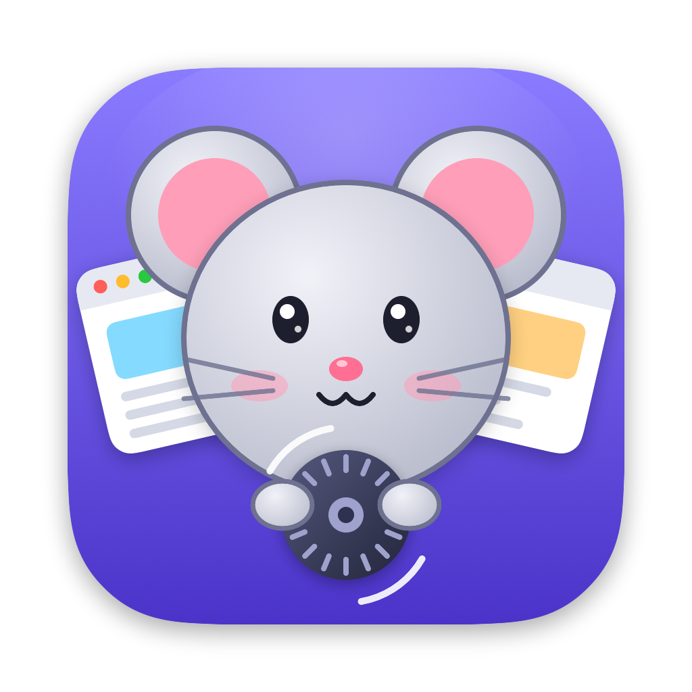
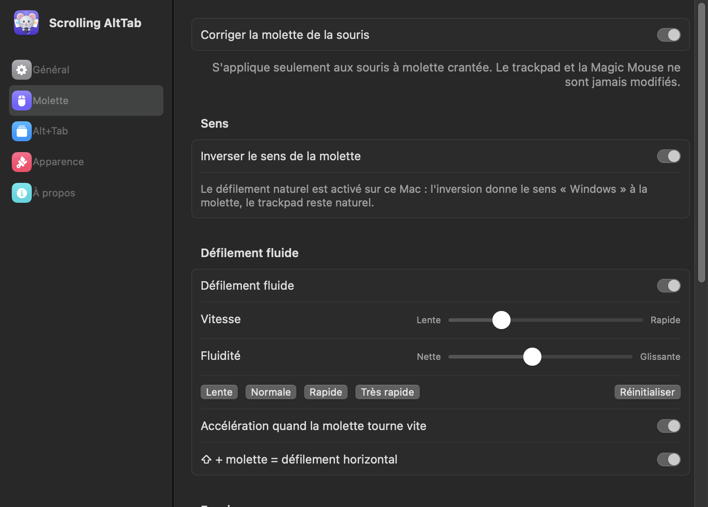
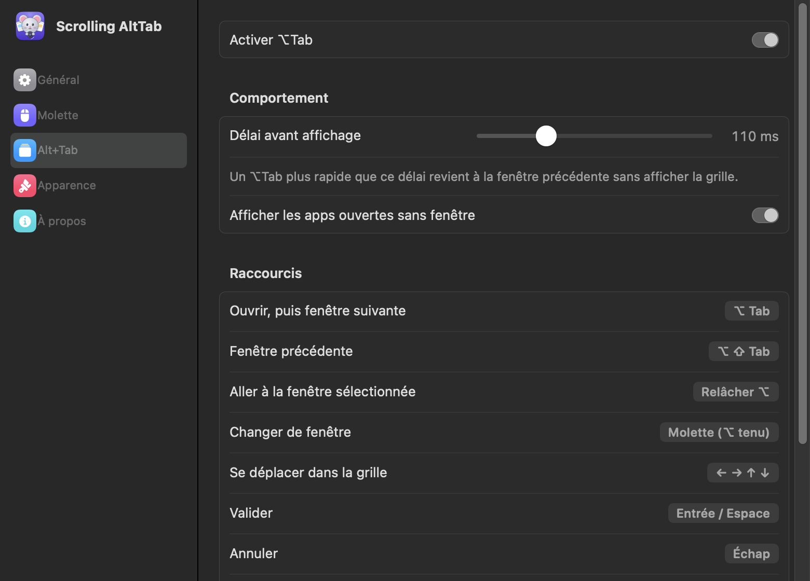

# Scrolling AltTab



Petite app de barre des menus macOS, avec **Molette** comme mascotte (une petite souris qui tient
une molette devant des fenêtres en éventail). Elle fait deux choses :

1. **Corrige la molette d'une souris classique** (crans, Bluetooth ou USB) :
   - défilement fluide au pixel près au lieu des sauts ligne par ligne (lissage du 3e ordre,
     calé sur le rafraîchissement de l'écran) ;
   - anti-rebond : les faux crans à l'envers des molettes bon marché sont ignorés, en pleine
     rotation comme au début d'un nouveau coup de molette (un vrai changement de sens est
     confirmé en 60 ms) ;
   - sens de la molette **indépendant du trackpad** (le trackpad garde le défilement naturel) ;
   - accélération quand on fait tourner la molette vite ;
   - ⇧ + molette = défilement horizontal ;
   - ⌘/⌃/⌥ + molette restent natifs (zoom, etc.) ;
   - désactivation du défilement fluide app par app.
   Le trackpad et la Magic Mouse ne sont jamais modifiés.
2. **⌥Tab façon Windows** : grille des fenêtres (avec aperçus si l'enregistrement d'écran est
   autorisé), dans l'ordre d'utilisation récente, avec les fenêtres des autres Spaces, réduites ou masquées.

> Projet indépendant, sans lien avec [AltTab](https://github.com/lwouis/alt-tab-macos).

<p align="center">
  
  
</p>

## Réglages

Icône souris de la barre des menus → **Réglages…** (⌘,), ou relancer l'app depuis le Finder.
Fenêtre à barre latérale, comme celle d'AltTab :

| Page | Contenu |
|---|---|
| Général | activer molette / ⌥Tab, ouverture au démarrage, état des autorisations |
| Molette | sens, défilement fluide, curseurs vitesse et fluidité, préréglages, accélération, ⇧ horizontal, zone d'essai, apps exclues |
| Alt+Tab | délai avant affichage, apps sans fenêtre, aide-mémoire des raccourcis |
| Apparence | aperçus des fenêtres, taille des vignettes, prévisualisation |
| À propos | Molette, version |

Le menu de la barre garde les réglages rapides. Une seule copie de l'app peut tourner : la
dernière lancée ferme les autres (sinon la molette serait lissée deux fois).

## Raccourcis

| Touche | Effet |
|---|---|
| ⌥Tab / ⌥⇧Tab | ouvrir, puis fenêtre suivante / précédente |
| relâcher ⌥ | aller à la fenêtre sélectionnée |
| ⌥Tab rapide | revenir à la fenêtre précédente sans afficher la grille |
| molette (⌥ tenu) | changer de fenêtre |
| ← → ↑ ↓ | se déplacer dans la grille |
| Entrée / Espace | valider |
| Échap | annuler |
| Q / W / M / H | quitter l'app / fermer la fenêtre / réduire / masquer l'app |
| souris | survol = sélection, clic = valider |

## Prérequis

- macOS 14 Sonoma ou plus récent, Apple Silicon (le script compile pour arm64)
- Outils en ligne de commande d'Apple (`xcode-select --install`) ; Xcode n'est pas nécessaire

## Compiler et lancer

```bash
scripts/build-app.sh
```

```bash
open build/ScrollingAltTab.app
```

Au premier lancement :
- si AltTab tourne, l'app propose de le quitter (les deux se disputeraient ⌥Tab) ;
- autoriser **Accessibilité** (Réglages Système → Confidentialité et sécurité) : obligatoire ;
- optionnel : **Enregistrement d'écran** pour les aperçus (menu de l'icône souris).

Signature : macOS lie l'autorisation Accessibilité à la signature de l'app. Sans certificat, le
script signe « ad hoc » et **chaque recompilation fait perdre l'autorisation** (retirer l'entrée
puis la recréer dans Réglages Système). Pour l'éviter, créer une fois un certificat de signature
de code nommé `ScrollingAltTab Local Signing` dans le trousseau de session (Trousseaux d'accès →
Assistant de certification → Créer un certificat, type « Signature de code ») : le script
l'utilise automatiquement. Autre nom :

```bash
SIGN_IDENTITY="Nom du certificat" scripts/build-app.sh
```

## Auto-tests (sans toucher aux évènements)

```bash
build/ScrollingAltTab.app/Contents/MacOS/ScrollingAltTab --simulate-scroll
```

```bash
build/ScrollingAltTab.app/Contents/MacOS/ScrollingAltTab --replay-trace trace.txt
```

(`--replay-trace` rejoue un enregistrement de crans réels, lignes `RAW <ms> d=<lignes>`, dans le
filtre anti-rebond et le lissage, et affiche inversions et à-coups.)

```bash
build/ScrollingAltTab.app/Contents/MacOS/ScrollingAltTab --list-windows
```

```bash
build/ScrollingAltTab.app/Contents/MacOS/ScrollingAltTab --render-preview /tmp/apercu.png
```

```bash
build/ScrollingAltTab.app/Contents/MacOS/ScrollingAltTab --render-settings /tmp
```

Régénérer l'icône après avoir modifié `Mascot.swift` :

```bash
build/ScrollingAltTab.app/Contents/MacOS/ScrollingAltTab --render-icon /tmp && iconutil -c icns /tmp/AppIcon.iconset -o Resources/AppIcon.icns
```

## Code

| Fichier | Rôle |
|---|---|
| `EventTap.swift` | un seul event tap session (clavier + molette), sur son propre thread |
| `ScrollEngine.swift` | correction de la molette, easing exponentiel à 120 Hz sur une file dédiée |
| `SwitcherController.swift` | machine à états ⌥Tab, panneau, aperçus |
| `SwitcherView.swift` | interface SwiftUI de la grille |
| `WindowStore.swift` | énumération des fenêtres (AX + jetons distants pour les autres Spaces), ordre MRU |
| `PrivateAPIs.swift` | API privées SkyLight/HIServices chargées par `dlsym` |
| `Settings.swift` | préférences (UserDefaults) |
| `SettingsView.swift` | fenêtre de réglages SwiftUI |
| `Mascot.swift` | Molette en dessin vectoriel : icône, page À propos, icône de barre des menus |

Les API privées sont chargées dynamiquement : si une mise à jour de macOS en retire une, la
fonction concernée se dégrade (pas d'aperçu, pas de fenêtres des autres Spaces, activation
classique de l'app) au lieu de planter.

## Licence

[MIT](LICENSE).
